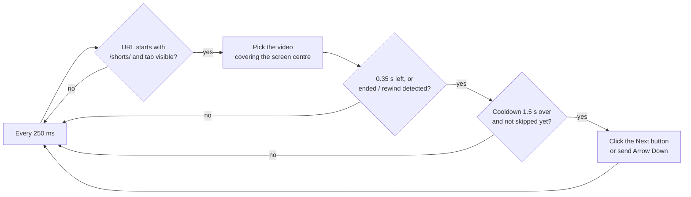

<p align="center"></p>

<h1 align="center">Talitha · Auto Shorts</h1>

<p align="center">
  <b>Watch YouTube Shorts hands-free.<br>When a Short ends, Talitha jumps to the next one.</b>
</p>

<p align="center">
  
  
  
  
  
  
  
</p>

<p align="center">
  <a href="#-install">Install</a> ·
  <a href="#-using-it">Usage</a> ·
  <a href="#-how-it-works">How it works</a> ·
  <a href="#-tests">Tests</a> ·
  <a href="README.tr.md">🇹🇷 Türkçe</a>
</p>

---

## 🌟 What it does

YouTube Shorts loops each video forever until you swipe. Talitha removes the swiping: a moment before the current Short ends, it presses *Next* for you.

- ⏭️ **Auto-advance.** Moves on just before the video loops back.
- 🔘 **One-click switch.** The toolbar icon opens a small popup with an on/off toggle.
- 🏷️ **A badge that tells the truth.** Green `ON` on a YouTube tab when the toggle is on; grey `OFF` on every other tab.
- 😴 **Pauses in the background.** If the Shorts tab is hidden, scrolling stops and resumes when you come back.
- 🎯 **Scoped.** Runs only on `youtube.com/shorts/` pages.
- 🌍 **English and Turkish.** Picked automatically from Chrome's interface language.
- 🔒 **Private by design.** No servers, no tracking. The only permission is `storage`, used to remember the toggle.

## 📥 Install

Talitha is not on the Chrome Web Store yet, so you load it unpacked:

1. Download or clone this repository.
   ```bash
   git clone https://github.com/tariktunc/talitha-youtube-shorts-auto-scroll.git
   ```
2. Open `chrome://extensions` in Chrome.
3. Turn on **Developer mode** (top right).
4. Click **Load unpacked** and choose the project folder.
5. Open any YouTube Short. The badge shows `ON` when the extension is active.

## 🕹️ Using it

| You want to… | Do this |
|---|---|
| Start auto-advancing | Open a Short with the toggle **on**. The badge reads `ON`. |
| Stop it | Click the toolbar icon and switch the toggle **off**. |
| Pause while you read comments | Switch to another tab; Talitha waits until you come back. |
| Rewind a Short | Just do it. Talitha will not skip if you scrub backwards. |

### Badge states

| Badge | Meaning |
|---|---|
| 🟢 `ON` | You are on `https://www.youtube.com/` and the toggle is on. |
| ⚪ `OFF` | You are on any other site, or the toggle is off. |

Look-alike addresses such as `www.youtube.com.evil.com` or `http://` pages never get the green badge.

## 🧠 How it works



1. **Watch.** Every 250 ms the content script checks that the address starts with `/shorts/`.
2. **Find the active Short.** The video covering the middle of the screen is the one being watched.
3. **Catch the end.** YouTube loops the video and rewinds it without firing `ended`, so Talitha advances **0.35 s before the end**. It also watches for the rewind and for the `ended` flag as a backup.
4. **Move on.** It clicks the *Next video* button. If the button is missing, it sends the Arrow Down key.
5. **Don't overshoot.** It waits 1.5 s between jumps and never jumps twice on the same video.
6. **Stay quiet.** If the tab is not visible, it never jumps.

The badge is driven by `background.js`, which only looks at the tab's address. That is why `manifest.json` holds a single host permission, `https://www.youtube.com/*`: Talitha cannot read the address of any other site.

### 🗂️ Project layout

| File | Role |
|---|---|
| `manifest.json` | Extension definition (Manifest V3) |
| `logic.js` | Decision logic. No DOM access, tested in Node |
| `content.js` | Watches the page, finds the video, clicks the button |
| `background.js` | The `ON` / `OFF` badge |
| `popup.html` · `popup.css` · `popup.js` | The toolbar popup with the toggle |
| `_locales/en`, `_locales/tr` | Language packs (name, description, popup text) |
| `icons/` | Logo (`icon.svg` and PNG sizes) |
| `test/` | Unit tests: logic, locales, popup link, content script in a fake page, icons |
| `e2e/extension.e2e.js` | End-to-end tests in a real Chromium |

## 🌍 Add a language

Copy `_locales/en/messages.json` to `_locales/<language-code>/messages.json` and translate the strings. The locale tests check that every key exists in every language and that Chrome Web Store length limits are respected.

## 🧪 Tests

Node.js 18 or newer. No extra packages for the unit tests.

```bash
node --test            # or: npm test
```

**35 unit tests** cover the badge rule (look-alike URLs rejected), no scrolling in hidden tabs, the footer link to blakfy.com opening safely in a new tab, language packs (same keys, no empty strings, store length limits), active-video selection, end detection (before the end, `ended`, rewind), no skip when the user rewinds, the cooldown, and a replay of the loop behaviour measured on a real page.

**13 end-to-end tests** load the extension into a real Chromium:

```bash
npm install
npx playwright-core install chromium
npm run test:e2e
```

They check the badge across tabs, the popup toggle and its persistence, the localised name and description, the footer link, and, on real YouTube Shorts, that the extension advances when on and stays still when off. If Shorts fail to load, the test is reported as skipped, not passed. Headless Chromium cannot really hide tabs, so the "no scrolling in a background tab" case is covered by unit tests only.

## 🚧 Known limits

- Works only on the `/shorts/` page, not on the Shorts shelf of the home or subscriptions page.
- If YouTube changes its page structure, the selector of the *Next video* button (`#navigation-button-down button`) may need an update.
- Not published on the Chrome Web Store; load it unpacked.

## ✨ About the name

Talitha is a star in the Big Dipper's paw, known as *"the third leap of the gazelle"*. The extension's whole job is to leap from one video to the next.

---

<p align="center"><sub>Operated by <a href="https://blakfy.com">Blakfy Studio</a></sub></p>
