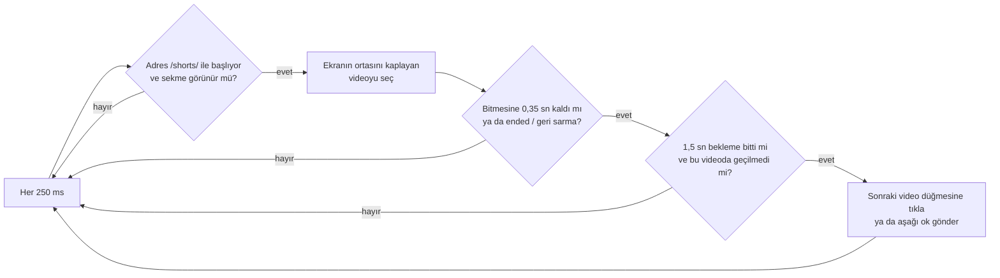

<p align="center"></p>

<h1 align="center">Talitha · Auto Shorts</h1>

<p align="center">
  <b>YouTube Shorts'u elini sürmeden izle.<br>Bir Short bitince Talitha sonrakine geçer.</b>
</p>

<p align="center">
  
  
  
  
  
  
  
</p>

<p align="center">
  <a href="#-kurulum">Kurulum</a> ·
  <a href="#-kullanım">Kullanım</a> ·
  <a href="#-nasıl-çalışır">Nasıl çalışır</a> ·
  <a href="#-testler">Testler</a> ·
  <a href="README.md">🇬🇧 English</a>
</p>

---

## 🌟 Ne yapar?

YouTube Shorts her videoyu sen kaydırana kadar döngüde oynatır. Talitha kaydırmayı senin yerine yapar: Short bitmeden hemen önce *Sonraki video* düğmesine basar.

- ⏭️ **Otomatik geçiş.** Video başa sarmadan hemen önce bir sonrakine geçer.
- 🔘 **Tek tıkla aç/kapa.** Araç çubuğundaki simge, düğmeli küçük bir pencere açar.
- 🏷️ **Dürüst rozet.** YouTube sekmesinde düğme açıksa yeşil `ON`, diğer tüm sekmelerde gri `OFF`.
- 😴 **Arka planda durur.** Shorts sekmesi gizliyse kaydırma durur, sekmeye dönünce devam eder.
- 🎯 **Dar kapsam.** Yalnızca `youtube.com/shorts/` adreslerinde çalışır.
- 🌍 **Türkçe ve İngilizce.** Chrome'un arayüz diline göre otomatik seçilir.
- 🔒 **Tasarımdan gizli.** Sunucu yok, izleme yok. Tek izin `storage`; açık/kapalı durumunu saklar.

## 📥 Kurulum

Talitha henüz Chrome Web Store'da değil; paketlenmemiş olarak yüklenir:

1. Bu repoyu indirin veya klonlayın.
   ```bash
   git clone https://github.com/tariktunc/talitha-youtube-shorts-auto-scroll.git
   ```
2. Chrome'da `chrome://extensions` sayfasını açın.
3. Sağ üstten **Geliştirici modu**'nu açın.
4. **Paketlenmemiş öğe yükle**'ye tıklayıp proje klasörünü seçin.
5. Bir Shorts videosu açın. Eklenti etkinken rozet `ON` gösterir.

## 🕹️ Kullanım

| Yapmak istediğin | Nasıl |
|---|---|
| Otomatik geçişi başlat | Düğme **açıkken** bir Short aç. Rozet `ON` yazar. |
| Durdur | Araç çubuğundaki simgeye tıkla, düğmeyi **kapat**. |
| Yorumları okurken beklet | Başka sekmeye geç; Talitha sen dönene kadar bekler. |
| Short'u geri sar | Sar yeter. Geri sarınca Talitha atlamaz. |

### Rozet durumları

| Rozet | Anlamı |
|---|---|
| 🟢 `ON` | `https://www.youtube.com/` üzerindesin ve düğme açık. |
| ⚪ `OFF` | Başka bir sitedesin ya da düğme kapalı. |

`www.youtube.com.evil.com` ya da `http://` gibi benzer görünen adresler yeşil rozet almaz.

## 🧠 Nasıl çalışır



1. **İzle.** Her 250 ms'de adresin `/shorts/` ile başladığına bakar.
2. **Aktif videoyu bul.** Ekranın ortasını kaplayan video izlenen videodur.
3. **Bitişi yakala.** YouTube videoyu döngüye alır ve `ended` olayı vermeden başa sarar. Bu yüzden Talitha **bitmesine 0,35 saniye kala** geçer. Başa sarmayı ve `ended` bayrağını yedek olarak izler.
4. **Geç.** *Sonraki video* düğmesine tıklar. Düğme yoksa aşağı ok tuşunu gönderir.
5. **Fazla kaçma.** Geçişler arasında 1,5 sn bekler, aynı videoda iki kez geçmez.
6. **Sessiz kal.** Sekme görünür değilse hiç geçmez.

Rozeti `background.js` yönetir ve yalnızca sekmenin adresine bakar. Bu yüzden `manifest.json` içinde tek ana makine izni vardır: `https://www.youtube.com/*`. Talitha başka sitelerin adresini okuyamaz.

### 🗂️ Dosyalar

| Dosya | Görev |
|---|---|
| `manifest.json` | Eklenti tanımı (Manifest V3) |
| `logic.js` | Karar mantığı. DOM'a dokunmaz, Node'da test edilir |
| `content.js` | Sayfayı izler, videoyu bulur, düğmeye tıklar |
| `background.js` | `ON` / `OFF` rozeti |
| `popup.html` · `popup.css` · `popup.js` | Simgeye tıklayınca açılan aç/kapa penceresi |
| `_locales/en`, `_locales/tr` | Dil paketleri (ad, açıklama, pencere metinleri) |
| `icons/` | Logo (`icon.svg` ve PNG boyutları) |
| `test/` | Birim testleri: mantık, diller, pencere bağlantısı, sahte sayfada içerik betiği, simgeler |
| `e2e/extension.e2e.js` | Gerçek Chromium'da uçtan uca testler |

## 🌍 Dil ekle

`_locales/en/messages.json` dosyasını `_locales/<dil-kodu>/messages.json` olarak kopyalayıp metinleri çevirin. Dil testleri her anahtarın her dilde bulunduğunu ve Chrome Web Store uzunluk sınırlarının aşılmadığını denetler.

## 🧪 Testler

Node.js 18 veya üstü gerekir. Birim testleri için ek paket gerekmez.

```bash
node --test            # ya da: npm test
```

**35 birim testi:** rozet kuralı (benzer görünen adresler reddedilir), gizli sekmede kaydırma yok, pencere altındaki blakfy.com bağlantısının yeni sekmede güvenle açılması, dil paketleri (aynı anahtarlar, boş metin yok, mağaza uzunluk sınırları), aktif video seçimi, bitiş yakalama (bitmeden önce, `ended`, başa sarma), kullanıcı geri sararsa geçmeme, geçişler arası bekleme ve gerçek sayfada ölçülen döngü davranışının tekrar oynatılması.

**13 uçtan uca test** eklentiyi gerçek bir Chromium'a yükler:

```bash
npm install
npx playwright-core install chromium
npm run test:e2e
```

Sekmeler arası rozet, pencere düğmesi ve kalıcılığı, yerelleştirilmiş ad ve açıklama, alt bağlantı ve gerçek YouTube Shorts'ta açıkken geçiş / kapalıyken durma denetlenir. Shorts yüklenmezse test geçmiş sayılmaz, atlandı olarak raporlanır. Başsız Chromium sekmeleri gerçekten gizleyemediği için "arka plan sekmesinde kaymıyor" durumu yalnızca birim testleriyle sınanır.

## 🚧 Bilinen sınırlar

- Ana sayfadaki veya abonelikler sayfasındaki Shorts şeridinde çalışmaz; yalnızca `/shorts/` sayfasında çalışır.
- YouTube sayfa yapısını değiştirirse *Sonraki video* düğmesinin seçicisi (`#navigation-button-down button`) güncellenmelidir.
- Chrome Web Store'da yayınlanmış değildir; paketlenmemiş olarak yüklenir.

## ✨ Adın hikâyesi

Talitha, Büyük Ayı'nın pençesindeki bir yıldızdır; "ceylanın üçüncü sıçrayışı" olarak bilinir. Eklentinin tek işi de bir videodan ötekine sıçramak.

---

<p align="center"><sub>Operated by <a href="https://blakfy.com">Blakfy Studio</a></sub></p>
